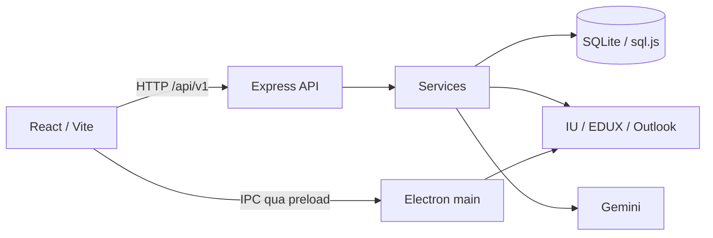

# Smart Study Hub — CMC University

**Smart Study Hub** là ứng dụng hỗ trợ học tập dành cho sinh viên Đại học CMC, tập hợp lịch học, công việc, lịch thi, tài liệu, ghi chú và các công cụ AI trong một không gian làm việc. Dự án còn được gọi là **UniStudy CMC** trong một số thành phần mã nguồn.

Ứng dụng kết nối dữ liệu từ **IU**, **EDUX** và **Outlook**, giúp sinh viên theo dõi việc học, chủ động sắp xếp thời gian và ôn tập dựa trên học liệu của mình. Giao diện React chạy trong Electron hoặc trình duyệt; dữ liệu nghiệp vụ được lưu trên máy qua SQLite.

[Cài đặt](#cài-đặt-và-khởi-chạy) · [Chức năng](#các-chức-năng-của-dự-án) · [Cách sử dụng](#bắt-đầu-sử-dụng) · [Kiến trúc](#kiến-trúc-hệ-thống) · [Tài liệu](#tài-liệu-dự-án) · [Nhóm phát triển](#nhóm-phát-triển)

## Mục tiêu

- Tập trung thông tin học tập từ các hệ thống trường để sinh viên dễ theo dõi lịch, deadline và kỳ thi.
- Kết nối việc lập kế hoạch, học với tài liệu, ghi chép, tập trung và tự kiểm tra kiến thức.
- Dùng dữ liệu học tập có thật làm ngữ cảnh cho AI; cho người học xem lại đề xuất trước khi áp dụng.
- Lưu lại công việc, lịch, kết quả học và ghi chú để tiếp tục sử dụng sau khi đóng ứng dụng.

## Các chức năng của dự án

| STT | Chức năng | Nội dung chính |
| --- | --- | --- |
| 1 | Thời khóa biểu thông minh | Xem lịch lớp và lịch tự học theo tuần/tháng/danh sách; hiển thị môn, giờ, phòng và giảng viên khi nguồn có dữ liệu. |
| 2 | Lập kế hoạch tự học bằng AI | Đề xuất buổi học từ khoảng trống, cảnh báo trùng lịch, cho chỉnh và xác nhận trước khi lưu. |
| 3 | Deadline và checklist | Quản lý công việc cá nhân, bài tập EDUX, hạn nộp, ưu tiên, trạng thái và các đầu việc con. |
| 4 | Nhắc nhở học tập | Theo dõi deadline và kỳ thi qua các mốc nhắc, danh sách thông báo và trạng thái đã đọc. |
| 5 | Kho tài liệu môn học | Tải lên/mở/tải xuống tài liệu; đọc chương, slide, ảnh EDUX và PDF; tóm tắt toàn môn, tạo flashcard từ bản tóm tắt. |
| 6 | Tìm kiếm và tag | Tìm nhanh công việc, lịch, tài liệu, ghi chú và email; gắn/lọc tag, mở đúng ngữ cảnh kết quả. |
| 7 | Gia sư AI | Hỏi đáp theo ngữ cảnh học tập, lưu hội thoại, xem lại lịch sử và thử lại khi provider lỗi. |
| 8 | Pomodoro | Đếm thời gian tập trung/nghỉ, pause/resume, khôi phục phiên và lưu lịch sử học tập. |
| 9 | Lịch thi và kế hoạch ôn tập | Đồng bộ lịch thi IU, quản lý kỳ thi tự nhập, theo dõi các giai đoạn ôn và trạng thái hoàn thành. |
| 10 | Time Map | Tổng hợp các khoảng lớp học, kỳ thi, tự học, Pomodoro và thời gian trống theo ngày. |
| 11 | Phân tích tiến độ | Theo dõi công việc, thời gian học, điểm/GPA và nhận xét AI từ dữ liệu đã ghi nhận. |
| 12 | Textbook và sổ tay | Sổ tay cấu trúc Tiptap với template/trang con/nháp; vở canvas có viết/vẽ, bảng, công thức, OCR và xuất tệp. |
| 13 | Quiz AI | Sinh câu hỏi theo môn/chủ đề/độ khó, làm bài, chấm tại server và lưu kết quả để xem lại. |
| 14 | Phân tích điểm yếu | Tổng hợp quiz đã nộp, xem câu sai và chủ đề cần ôn; so sánh các lần làm khi đủ dữ liệu. |
| 15 | Kế hoạch ôn thi bằng AI | Đề xuất giai đoạn/buổi ôn theo kỳ thi, lịch trống và kết quả học; kiểm tra lại xung đột khi xác nhận. |
| 16 | Hỗ trợ soạn đơn nghỉ học | Soạn từ ngày/môn/lý do và hồ sơ có thật; chỉnh sửa, lưu nháp, sao chép và xuất TXT/DOCX. |
| 17 | Email trường | Đồng bộ/đọc email Outlook, trích thông tin có trong thư và xác nhận chuyển thành công việc hoặc kỳ thi. |
| 18 | Hồ sơ học tập cá nhân | Xem thông tin sinh viên, môn học, bảng điểm, học kỳ, tín chỉ và GPA theo dữ liệu IU. |

Các nhóm chức năng dùng chung trang Tổng quan, trang Đồng bộ dữ liệu, tìm kiếm workspace và cài đặt giao diện/thông báo. Hướng dẫn thao tác và phạm vi từng tính năng nằm trong [FEATURES.md](docs/FEATURES.md).

## Công nghệ sử dụng

| Thành phần | Công nghệ |
| --- | --- |
| Ứng dụng desktop | Electron, IPC qua preload/contextBridge. |
| Giao diện | React 18, Vite 6, React Router, Axios, Lucide, Recharts. |
| Backend | Node.js, Express 4; tách route, controller, service, validator và middleware. |
| Lưu trữ | SQLite qua `sql.js`, migration tự động, thư mục tệp và cache trên máy. |
| Nguồn dữ liệu | Module kết nối IU, EDUX, Outlook/Graph và chuẩn hóa dữ liệu trong `CRWEB/`. |
| AI | Client Gemini, dựng ngữ cảnh học tập, kiểm tra đầu ra và hàng đợi tác vụ. |
| Ghi chép và học liệu | Tiptap/ProseMirror, PDF.js, KaTeX/MathJax, Tesseract.js, jsPDF và `docx`. |
| Kiểm thử | Node test runner, Vitest, React Testing Library, jsdom và các script tích hợp/Electron. |

## Cài đặt và khởi chạy

### Yêu cầu môi trường

- Git, Node.js và npm. Môi trường đã kiểm tra: **Windows, Node.js 24.16.0, npm 11.13.0**.
- Kết nối mạng khi cài dependency, đăng nhập các hệ thống trường hoặc sử dụng AI/OCR cần tải tài nguyên.
- Tài khoản trường được cấp quyền nếu sử dụng dữ liệu IU, EDUX và Outlook thực tế.

### Cài mã nguồn

```powershell
git clone https://github.com/hotrohoctapcmcu/smart_study_hub_cmc_uni.git
cd smart_study_hub_cmc_uni

# Cài dependency backend/Electron và frontend
npm ci
npm --prefix Frontend ci

# Tạo cấu hình cục bộ nếu chưa có
if (-not (Test-Path -LiteralPath '.env')) { Copy-Item .env.example .env }
if (-not (Test-Path -LiteralPath 'Frontend/.env')) { Copy-Item Frontend/.env.example Frontend/.env }
```

Các lệnh trên dùng PowerShell. Nếu execution policy chặn `npm.ps1`, sử dụng `npm.cmd` thay cho `npm`.

### Chạy ứng dụng desktop

```powershell
npm start
```

Lệnh tự build frontend rồi mở Electron. Máy chủ giao diện mặc định ở `http://localhost:8080`, API ở `http://localhost:3001/api/v1`. Đây là cách chạy từ mã nguồn; dự án hiện chưa có script đóng gói bộ cài độc lập.

### Chạy khi phát triển

Mở hai terminal tại thư mục gốc:

```powershell
# Terminal 1: Express API
npm run dev:api

# Terminal 2: React/Vite tại http://127.0.0.1:5173
npm --prefix Frontend run dev
```

Các chế độ khác:

| Lệnh | Mục đích |
| --- | --- |
| `npm run start:headless` | Build và phục vụ ứng dụng trong trình duyệt, chạy cùng backend. |
| `npm --prefix Frontend run dev:mock` | Phát triển giao diện bằng dữ liệu giả lập. |
| `npm --prefix Frontend run build` | Tạo bản production tại `Frontend/dist`. |
| `npm --prefix Frontend run preview` | Xem bản frontend đã build; khởi động backend riêng nếu dùng API thật. |

Đăng nhập Microsoft qua cửa sổ ứng dụng cần Electron. Chế độ trình duyệt/headless dùng phiên hoặc token được cấp cho backend theo [hướng dẫn API](docs/API.md).

## Bắt đầu sử dụng

1. Mở **Đồng bộ dữ liệu**, kết nối IU, EDUX và Outlook theo nguồn cần dùng. IU cung cấp hồ sơ và phạm vi môn đang học để gắn dữ liệu đúng sinh viên.
2. Xem **Tổng quan**, **Lịch học**, **Công việc** và **Kỳ thi**; thêm checklist hoặc lịch tự học khi cần.
3. Vào **Tài liệu → Bài giảng**, chọn môn/chương/slide hoặc tải lên tài liệu riêng. Có thể tóm tắt toàn môn và ôn bằng flashcard.
4. Dùng **Sổ tay** để ghi bằng bàn phím hoặc **Vở ghi** để viết/vẽ; dùng **Pomodoro** trong khu vực Học tập để ghi nhận thời gian tập trung.
5. Hỏi **Trợ lý AI**, làm quiz, xem điểm yếu và xem lại đề xuất ôn tập trước khi xác nhận lưu lịch.
6. Theo dõi **Thống kê**, **Hồ sơ** và **Email**; kiểm tra thông tin trích từ thư trước khi tạo công việc/kỳ thi.

`Ctrl+K` / `⌘+K` mở tìm kiếm workspace. Sổ tay, vở canvas và các phần đánh dấu học liệu có cách lưu khác nhau; xem [hướng dẫn sử dụng](docs/FEATURES.md) trước khi sao lưu hoặc chuyển máy.

## Kiến trúc hệ thống



Frontend gọi API để đọc/ghi dữ liệu. Backend kiểm tra đầu vào, xử lý nghiệp vụ, kết nối nguồn và lưu SQLite. Electron quản lý cửa sổ đăng nhập cùng bridge cho renderer. Các kế hoạch AI được tạo dưới dạng xem trước; server đọc lại lịch và kiểm tra xung đột trước khi lưu sau xác nhận.

```text
smart_study_hub_cmc_uni/
├── API/                         # Express API
│   ├── routes/                  # Method/path và kết nối controller
│   ├── controllers/             # Xử lý HTTP request/response
│   ├── services/                # Nghiệp vụ, đồng bộ, AI và workspace
│   ├── validators/              # Kiểm tra dữ liệu đầu vào
│   ├── middlewares/             # Middleware và xử lý lỗi
│   ├── utils/                   # Client nguồn, context và tiện ích
│   └── tests/                   # Kiểm thử contract/database
├── CRWEB/
│   ├── modules/                 # Kết nối IU, EDUX, Outlook và chuẩn hóa dữ liệu
│   └── shared/                  # Luồng kết nối dùng chung
├── database/
│   ├── connection/              # Connection, transaction và persist
│   ├── schema/                  # Schema SQLite ban đầu
│   ├── migrations/              # Nâng cấp cấu trúc dữ liệu
│   ├── modules/                 # Các nghiệp vụ lưu trữ
│   └── shared/                  # Helper và kiểm tra toàn vẹn
├── electron/                    # Main process, preload và IPC bridges
├── Frontend/
│   └── src/                     # Pages, components, API, hooks, test
├── tests/                       # Hồi quy, tích hợp và smoke scripts
├── docs/                        # Tài liệu kỹ thuật và báo cáo sprint
├── .env.example                 # Cấu hình backend mẫu
├── index.js                     # Chạy API và phục vụ frontend build
└── package.json                 # Dependency và lệnh tại thư mục gốc
```

Chi tiết luồng khởi động, module database và migration: [ARCHITECTURE.md](docs/ARCHITECTURE.md). Hợp đồng endpoint, đồng bộ và xử lý tác vụ AI: [API.md](docs/API.md).

## Cấu hình

Backend đọc `.env` ở thư mục gốc; Vite đọc `Frontend/.env`. Dùng hai file `.env.example` làm mẫu.

| Biến | Mặc định / mục đích |
| --- | --- |
| `DB_PATH` | `./data/unistudy.db`, file database trên máy chạy backend. |
| `API_PORT` | `3001`, cổng API. |
| `API_BASE` | `http://localhost:3001`, URL backend dùng bởi bridge Electron, không kèm `/api/v1`. |
| `APP_USER_ID` | `1`, hồ sơ được API sử dụng. |
| `VITE_API_URL` | `http://localhost:3001/api/v1`, URL gọi API từ frontend. |
| `VITE_USE_MOCK` | `false`; bật khi phát triển với dữ liệu giả lập. |
| `DOCUMENTS_PATH` | Thư mục file tải lên, mặc định `documents/` cạnh database. |
| `EDUX_ACCOUNTS_PATH` | Thư mục thông tin tài khoản EDUX cục bộ, mặc định `edux-accounts/` cạnh database. |
| `EDUX_IMAGES_PATH` | Thư mục cache ảnh học liệu, mặc định `edux-images/` cạnh database. |
| `GEMINI_TIMEOUT_MS` | `45000`, giới hạn thời gian gọi Gemini. Provider hiện dùng phiên web khách. |
| `OUTLOOK_ACCESS_TOKEN` | Tùy chọn cho headless; token Graph có quyền `Mail.Read`. |

Nếu đổi `API_PORT`, cập nhật cùng `API_BASE` và `VITE_API_URL`. `JWT_SECRET` và `ALLOWED_ORIGINS` còn trong file mẫu nhưng chưa được dùng cho xác thực nội bộ hoặc giới hạn CORS; cấu hình thực tế nằm trong `API/config/index.js`.

## Lưu trữ và sao lưu

| Dữ liệu | Nơi lưu |
| --- | --- |
| Hồ sơ, lịch, task, điểm, email, lịch sử AI, notes và dữ liệu học liệu | SQLite theo `DB_PATH`. |
| File tải lên và ảnh slide | Các thư mục tài liệu/cache cạnh database hoặc đường dẫn cấu hình riêng. |
| Nội dung sổ tay cấu trúc | SQLite qua API; có nháp trình duyệt để phục hồi khi lưu lỗi. |
| Vở canvas, bookmark/tiến độ/ghi chú slide | localStorage của trình duyệt theo origin và phạm vi hồ sơ tương ứng. |
| Tài khoản EDUX đã nhớ | JSON cục bộ chứa email/mật khẩu để khôi phục kết nối. |

Để sao lưu, dừng ứng dụng rồi sao chép database cùng các thư mục file cần giữ. Với vở canvas, xuất JSON để giữ khả năng chỉnh sửa; bản PDF/ảnh chỉ giữ nội dung hiển thị. Các origin Vite và cổng 8080 có kho localStorage riêng.

`.env`, dữ liệu người dùng, database, cookie, dependency, bản build và artifact kiểm thử được Git bỏ qua. Repository chỉ chứa cấu hình mẫu. Vị trí và vòng đời từng loại dữ liệu được mô tả trong [kiến trúc](docs/ARCHITECTURE.md#nơi-lưu-dữ-liệu-và-sao-lưu).

## Kiểm thử

Chạy tại thư mục gốc sau khi cài đủ dependency:

| Lệnh | Phạm vi |
| --- | --- |
| `npm run test:api` | Contract, database, HTTP regression và nghiệp vụ học tập. |
| `npm run test:database` | Connection, transaction, quan hệ và persist. |
| `npm run test:ai` | Context, provider, tóm tắt, quiz và kế hoạch AI. |
| `npm run test:electron` | Entry/preload/IPC, phiên, lịch thi và timeout kết nối. |
| `npm run test:course-learning` | Môn hiện tại, học liệu EDUX, tóm tắt, flashcard và refresh. |
| `npm run test:frontend-api` | Wrapper frontend kết nối API thật với database tạm. |
| `npm --prefix Frontend test -- --maxWorkers=2` | Unit/integration React bằng Vitest/jsdom. |
| `npm --prefix Frontend run build` | Build production; chạy riêng sau bộ test frontend. |

Các bộ tự động chủ yếu sử dụng dữ liệu tạm và provider giả lập. Đăng nhập trường, AI thật, browser/Electron E2E và thiết bị thật có các lượt kiểm tra riêng. Cách chạy, kết quả theo từng mốc và các ca chưa nghiệm thu nằm tại [TESTING.md](docs/TESTING.md).

## Phạm vi vận hành hiện tại

- Ứng dụng sử dụng một hồ sơ cấu hình; chưa có hệ thống xác thực/phân quyền nhiều tài khoản hoặc đồng bộ liên thiết bị.
- Nguồn trường phụ thuộc phiên đăng nhập, quyền tài khoản và cấu trúc dịch vụ bên ngoài. Học liệu đã lưu có thể đọc lại, nhưng thao tác đồng bộ/AI cần kết nối tương ứng.
- AI có thể sai kiến thức. Người học cần kiểm tra quiz, bản tóm tắt, đơn và lịch đề xuất trước khi sử dụng.
- Email chỉ được đọc/phân tích; ứng dụng không tự gửi thư hoặc nộp đơn nghỉ lên trường.
- Vở canvas và một số dữ liệu trình duyệt cần sao lưu riêng; OCR, lực nhấn bút và trải nghiệm thiết bị phụ thuộc môi trường thực tế.

## Nhóm phát triển

| Thành viên | GitHub | Vai trò trong dự án |
| --- | --- | --- |
| Văn Tuấn | [vtishan](https://github.com/vtishan) | Nhóm trưởng, kiến trúc hệ thống, Electron, AI và tích hợp. |
| Anh Tuấn | [AnhTuancode-25](https://github.com/AnhTuancode-25) | Phân tích, thu thập, chuẩn hóa và đối soát dữ liệu IU/EDUX/Outlook. |
| Long Nhật | [longnhatdinhviet8-byte](https://github.com/longnhatdinhviet8-byte) | Backend API, validation, nghiệp vụ và kiểm thử tích hợp. |
| Hồng Thắm | [Tham2007](https://github.com/Tham2007) | Database, schema/migration, toàn vẹn dữ liệu và lưu trữ. |
| Huyền Trang | [kieudu-dlst](https://github.com/kieudu-dlst) | Frontend React/Vite, UI/UX và tích hợp giao diện. |

Chi tiết trách nhiệm và công việc theo từng giai đoạn nằm trong backlog, báo cáo sprint và [GitHub Issues](https://github.com/hotrohoctapcmcu/smart_study_hub_cmc_uni/issues).

## Tài liệu dự án

| Tài liệu | Nội dung |
| --- | --- |
| [Hướng dẫn tính năng](docs/FEATURES.md) | Cách sử dụng các khu vực, học liệu, sổ tay, vở ghi và AI. |
| [Kiến trúc](docs/ARCHITECTURE.md) | Các tầng, luồng dữ liệu, module, migration và sao lưu. |
| [API](docs/API.md) | Endpoint, request/response, đồng bộ nguồn và tác vụ AI. |
| [Product backlog](docs/product_backlog.md) | Phạm vi, ưu tiên, trách nhiệm và tiêu chí nghiệm thu. |
| [Kiểm thử](docs/TESTING.md) | Lệnh chạy, bằng chứng theo phiên bản và giới hạn xác minh. |
| [Sprint 1](docs/SPRINT_1.md) | Nền tảng và các nghiệp vụ quản lý học tập cốt lõi. |
| [Sprint 2](docs/SPRINT_2.md) | Học liệu, công cụ học tập và tích hợp dữ liệu. |
| [Sprint 3](docs/SPRINT_3.md) | Các luồng AI học tập và tích hợp tổng thể. |
| [Sprint 4](docs/SPRINT_4.md) | Đợt tái cấu trúc/mở rộng, phân công và nghiệm thu bản bàn giao. |

## Phát triển và đóng góp

[`main`](https://github.com/hotrohoctapcmcu/smart_study_hub_cmc_uni/tree/main) chứa phiên bản hiện tại của toàn dự án. [`before`](https://github.com/hotrohoctapcmcu/smart_study_hub_cmc_uni/tree/before) lưu phiên bản main trước đợt cập nhật.

Tạo nhánh `feature/<github-login>/<noi-dung>` từ `main`, thực hiện thay đổi và mở PR về `main`. Dẫn issue liên quan, mô tả hành vi sau thay đổi, cách kiểm tra, kết quả và giới hạn còn lại; bổ sung ảnh nếu thay đổi giao diện. Cập nhật tài liệu kỹ thuật tương ứng khi thay đổi API, dữ liệu hoặc cách sử dụng.
