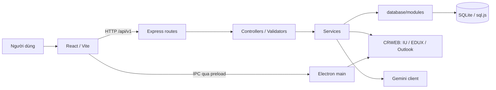

# Kiến trúc và luồng dữ liệu

Cập nhật cấu trúc tài liệu ngày **30/10/2026** theo working tree hiện tại. Các đường dẫn `API/modules`, `API/shared`, `database/sprint1Service.js` và frontend `src/features` thuộc cấu trúc cũ đã được thay thế.

## Các tầng

| Vị trí | Trách nhiệm |
| --- | --- |
| `electron/main.js` | Entry Electron, khởi động máy chủ và cửa sổ chính. |
| `index.js` | Chạy API và phục vụ `Frontend/dist` ở cổng 8080, hỗ trợ route React. |
| `electron/preload.js` | Cung cấp các namespace IPC cho renderer qua contextBridge. |
| `electron/bridges/` | Các bridge `iu.js`, `outlook.js`, `sync.js` cho đăng nhập và đồng bộ. |
| `Frontend/src/main.jsx`, `App.jsx` | Entry React, router và bố cục ứng dụng. |
| `Frontend/src/pages/`, `components/` | Trang tính năng và thành phần giao diện. |
| `Frontend/src/api/`, `hooks/`, `utils/` | HTTP client, adapter, quản lý dữ liệu và tiện ích. |
| `API/routes/` | Đăng ký method/path, alias và kết nối controller. |
| `API/controllers/` | Đọc request, gọi nghiệp vụ, trả status/body hoặc chuyển lỗi. |
| `API/services/` | Nghiệp vụ, truy vấn/tổng hợp dữ liệu, kiểm tra xung đột và gọi nguồn ngoài. |
| `API/validators/`, `middlewares/`, `utils/`, `config/` | Validate, lỗi HTTP, provider/session, cấu hình dùng chung. |
| `database/` | Connection SQLite, schema, migration, module nghiệp vụ và helper. |
| `CRWEB/modules/{IU,EDUX,OUTLOOK}/` | Đăng nhập, thu thập và chuẩn hóa dữ liệu từng cổng. |
| `CRWEB/shared/` | Luồng đăng nhập dùng chung; module không trực tiếp sở hữu việc lưu database ứng dụng. |
| `tests/`, `API/tests/`, `CRWEB/tests/`, `Frontend/src/test/` | Các bộ kiểm thử; kết quả sinh ra nằm trong `tests/artifacts/`. |

## Khởi động

1. `npm start` build React rồi mở `electron/main.js` theo `package.json.main`.
2. `index.js` chạy máy chủ frontend và gọi `API/index.js.start()`.
3. API nạp `.env` tại gốc, gọi `require('../database')()`, khởi tạo connection/schema/migration rồi truyền DB vào các route/service.
4. Electron cung cấp các bridge qua preload; cửa sổ dùng `contextIsolation: true`, `nodeIntegration: false` và sandbox.
5. React gọi API để lấy dữ liệu. Các trạng thái tải, rỗng, lỗi và thử lại được xử lý ở giao diện.

Máy chủ frontend phục vụ bản build trong `Frontend/dist`; chạy trực tiếp `node index.js` khi chưa build sẽ thiếu giao diện. Vite dùng cổng 5173 khi phát triển. Xem [cách khởi chạy](../README.md).

## Tầng database

`database/connection/db.js` quản lý connection dùng chung, transaction và persist file SQLite. `database/index.js` vừa là hàm kết nối, vừa tổng hợp các hàm nghiệp vụ để giữ tương thích với caller hiện có.

| Module trong `database/modules/` | Dữ liệu/nghiệp vụ |
| --- | --- |
| `profile.js`, `iuSync.js` | Hồ sơ, môn học, bảng điểm và ghi dữ liệu IU. |
| `schedule.js`, `study.js` | Lịch trường, lịch tự học, xung đột và hoàn thành buổi học. |
| `task.js`, `reminder.js` | Công việc, checklist, deadline và nhắc nhở. |
| `exam.js` | Kỳ thi và kế hoạch ôn thi. |
| `pomodoro.js`, `progress.js` | Phiên tập trung, thống kê, điểm theo kỳ/năm và học lại. |
| `notebook.js` | Sổ tay và ghi chú. |
| `eduxAssignment.js`, `eduxDocument.js` | Công việc/học liệu EDUX, đồng bộ và rollback. |

Schema gốc nằm trong `database/schema/00_sqlite_init.sql`; các thay đổi bổ sung nằm trong `database/migrations/`. Các nhóm bảng gồm hồ sơ/môn/điểm, `Timetables`, `StudySchedules`, `Assignments`, `Exams`, nhắc nhở, `PomodoroSessions`, `Notebooks`, `Notes`, học liệu EDUX và dữ liệu học tập AI.

`database/shared/academic.js` fallback sang hồ sơ đầu tiên khi mã không khớp; `studyStudent.js` yêu cầu mã sinh viên chính xác. Hai helper có quy tắc khác nhau và cần được giữ riêng khi sửa module.

## Nơi lưu dữ liệu và sao lưu

| Dữ liệu | Vị trí và vòng đời |
| --- | --- |
| Dữ liệu nghiệp vụ | `DB_PATH` hoặc `data/unistudy.db`; lưu trên máy qua SQLite. |
| File người dùng tải lên | `DOCUMENTS_PATH`, mặc định `documents/` cạnh file DB; metadata nằm trong SQLite. |
| Ảnh slide EDUX | `EDUX_IMAGES_PATH`, mặc định `edux-images/` cạnh DB; endpoint ảnh trả file đã cache. |
| Tài khoản EDUX | `EDUX_ACCOUNTS_PATH`, mặc định `edux-accounts/` cạnh DB; JSON chứa email và mật khẩu để đăng nhập lại. Trạng thái API không trả mật khẩu. |
| Phiên cổng dữ liệu | API giữ session/cookie hoạt động trong RAM; Electron có phiên Microsoft riêng và có thể khôi phục kết nối. |
| Sổ tay cấu trúc | Nội dung chuẩn trong `Notebooks`/`Notes`; nháp trình duyệt theo hồ sơ để phục hồi khi lưu lỗi. |
| Vở ghi Textbook | localStorage của origin hiện tại; cần xuất JSON để sao lưu nội dung còn chỉnh sửa được. |
| Job AI thông thường, job đồng bộ | Bộ nhớ tiến trình, mất khi API khởi động lại. Pipeline tóm tắt học liệu có phần tiến trình được lưu SQLite. |

Để sao lưu đầy đủ, dừng ứng dụng cho DB được persist rồi sao chép SQLite cùng thư mục file tải lên và cache ảnh tương ứng. Vở ghi cần bản JSON riêng; xuất PDF chỉ giữ hình ảnh trang. Thông tin tài khoản EDUX là dữ liệu riêng của máy, không đưa vào source hoặc báo cáo chia sẻ. Các quy tắc soạn thảo, export và hạn mức lưu trữ nằm trong [hướng dẫn tính năng](FEATURES.md).

## Luồng nghiệp vụ tiêu biểu

### Công việc và checklist

React gửi `POST /api/v1/tasks`; tầng validate/controller kiểm tra input, service gọi module task lưu công việc và các nhắc nhở phù hợp. Checklist dùng API `/tasks/:taskId/checklist`. Sau khi nhận kết quả, giao diện tải lại dữ liệu chuẩn, bao gồm công việc EDUX đã đồng bộ. Lỗi một lần ghi cần được thể hiện rõ để người dùng không nhầm dữ liệu nhập với dữ liệu đã lưu.

### Đồng bộ ba nguồn

Electron kết nối các cổng khi cần, sau đó frontend tạo job qua `POST /api/v1/sync`. API trả `202` và `jobId`; frontend theo dõi tiến trình, còn service thu thập/chuẩn hóa dữ liệu và gọi database để lưu. IU chạy trước EDUX để xác định môn đang học. Nguồn lỗi không chặn dữ liệu thành công từ nguồn khác. Quy tắc session, dữ liệu rỗng và cache xem [API và đồng bộ](API.md).

### AI và xác nhận lịch

Service dựng ngữ cảnh từ dữ liệu thật, gửi Gemini và validate đầu ra trước khi trả bản xem trước. Bản xem trước không ghi lịch. Khi người dùng xác nhận, API đọc lại toàn bộ lịch, kiểm tra xung đột và ghi trong transaction; không dùng ngữ cảnh AI đã cắt ngắn làm nguồn kiểm tra cuối.

### Học liệu theo môn

EDUX được giới hạn theo các môn IU đang học. Dữ liệu môn/chương/slide và bản tóm tắt được lưu, ảnh được cache thành file. Pipeline chia nguồn thành các phần để tóm tắt và tiếp tục sau lỗi; flashcard lấy từ bản tóm tắt cuối đã lưu. Đây là luồng riêng với job tóm tắt văn bản thông thường.

## Quy ước tích hợp

- Ngày lịch: `YYYY-MM-DD`, giờ `HH:mm`, timezone Việt Nam UTC+7; `day_of_week` từ Thứ Hai = 2 đến Chủ nhật = 8.
- Thiếu điểm khác điểm 0; giữ học kỳ, năm học và lần học lại khi ánh xạ dữ liệu.
- Đồng bộ lặp cần chống trùng và phân biệt nguồn trường với dữ liệu người dùng tự nhập.
- Pomodoro tính thời gian tập trung thực, loại pause/nghỉ; thống kê không đếm trùng với buổi tự học chồng thời gian.
- API hiện làm việc trên một hồ sơ cấu hình `APP_USER_ID`, mặc định 1. Đăng nhập các cổng ngoài không phải hệ thống tài khoản/phân quyền nội bộ.
- `CRWEB/modules/IU/payload/endpoint_map.txt` là tài nguyên được đọc khi chạy, không thuộc kho tài liệu để xóa/gộp.

Quy trình bàn giao và trách nhiệm từng tầng nằm trong [product backlog](product_backlog.md); các kết quả xác minh phải ghi đúng phạm vi tại [kiểm thử](TESTING.md).
