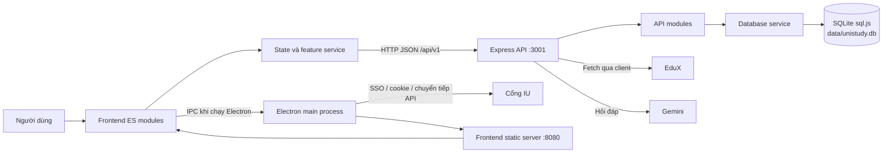

# Luồng xử lý hệ thống UniStudy CMC

Cập nhật sau tích hợp ngày 27/10/2026: xem [nguồn nhánh và kết quả kiểm thử](tich_hop_sprint2.md).

Tài liệu này mô tả luồng theo mã nguồn hiện có trong repository, từ lúc mở ứng dụng đến lúc dữ liệu được tải, xử lý và lưu. Hai ví dụ cuối tài liệu đi qua từng tầng: tạo bài tập kèm checklist và đồng bộ dữ liệu từ cổng IU.

## 1. Tổng quan kiến trúc

- `electron-main.js` nạp `index.js`, mở cửa sổ Electron và tải giao diện tại `http://localhost:8080`.
- `index.js` chạy máy chủ tĩnh Frontend ở cổng 8080 và khởi động `API/index.js`.
- API Express chạy mặc định ở cổng 3001, tiền tố `/api/v1`. `API/modules/index.js` gắn các router sinh viên, lịch, bài tập, thông báo, kỳ thi, đồng bộ và AI.
- Frontend khởi tạo ở `Frontend/src/app.js`; `bootstrap.js` dựng shell, đăng ký state listener và tải một số dữ liệu ban đầu bất đồng bộ.
- Mỗi tính năng thường chia thành `*.view.js` (HTML), `*.events.js` (thao tác UI), `*.service.js` (nghiệp vụ/gọi API) và file entry `*.js` (mount/unmount).
- `apiRequest()` trong `Frontend/src/shared/services/api-client.js` thay tham số URL, gửi JSON, áp dụng timeout và chuẩn hóa lỗi HTTP thành kết quả `{ success, error, unavailable }`.

## 2. Khởi động và nạp dữ liệu

1. Electron gọi `index.js`; máy chủ API và máy chủ Frontend được khởi chạy.
2. Electron tạo cửa sổ có `contextIsolation: true`, `nodeIntegration: false`, preload và zoom cố định ở 100%.
3. Frontend gọi `bootstrap()`, dựng shell và tab mặc định Tổng quan.
4. Trong nền, bootstrap tải hồ sơ, lịch trường, lịch tự học, công việc, kỳ thi và thông báo bằng `Promise.allSettled()`. Lỗi của một nguồn không chặn toàn bộ ứng dụng.
5. Khi một feature được mở, shell gọi hàm `mount...()` tương ứng, gắn event handler và render lại khi state thay đổi.

Database dùng `sql.js`/SQLite, tạo schema và tự chạy migration Sprint 2 trước khi nhận request. Mặc định file dữ liệu là `data/unistudy.db` (có thể đổi bằng `DB_PATH`). Ngoài các bảng Sprint 1, có `PomodoroSessions`, `Notebooks`, `Notes`, `EduxDocuments`, `EduxSyncLog`. Cổng `database/index.js` xuất chung dịch vụ hai Sprint.

## 3. Luồng và phạm vi từng nhóm tính năng

| Nhóm | Luồng xử lý / nơi lưu dữ liệu |
|---|---|
| **Tổng quan (Dashboard)** | `GET /api/v1/dashboard` tổng hợp hồ sơ, lịch hôm nay, deadline sắp tới, kỳ thi sắp tới và số nhắc nhở. Dữ liệu hồ sơ được cập nhật vào state; các thống kê thời gian lấy thêm từ lịch sử Pomodoro trên máy. |
| **Hồ sơ, môn học, điểm** | `GET/PUT /api/v1/student/profile`, `GET /grades`, `GET /subjects`; service ghép hồ sơ và bảng điểm vào `state.studentProfile`. Nếu chưa có GPA tổng hợp, frontend có phép tính dự phòng từ điểm chữ và tín chỉ đạt. |
| **Lịch học** | Lịch trường đọc từ SQLite (`/api/v1/schedules`); frontend bung lịch lặp theo thứ thành từng ngày để hiển thị. Lịch tự học có API đọc/thêm/sửa/xóa, đổi trạng thái, dò xung đột và tìm khoảng trống. Dữ liệu vào `state.schoolEvents` và `state.studyEvents`. |
| **Kế hoạch tự học** | Form gọi `POST /api/v1/ai/plan` với khoảng ngày và khung giờ; backend lấy khoảng trống thật, tạo đề xuất bằng AI rồi kiểm tra lại xung đột. Chỉ `/ai/plan/confirm` với xác nhận rõ ràng mới ghi các buổi học vào SQLite trong transaction. |
| **Công việc, deadline, checklist** | CRUD qua `/api/v1/tasks`; mục checklist qua `/api/v1/tasks/:taskId/checklist` và các route `/checklist/...`. Công việc và checklist chuẩn được lưu SQLite. Công việc EDUX được đọc từ bảng riêng và chuẩn hóa để hiển thị cùng danh sách. |
| **Nhắc nhở, thông báo** | API `/api/v1/notifications` đọc, tạo, đánh dấu đã đọc/đã gửi và xóa nhắc nhở SQLite. Khi tạo bài tập, database service tự tạo các mốc nhắc trước deadline nếu mốc đó còn ở tương lai. UI cũng có state thông báo cục bộ. |
| **Kỳ thi, kế hoạch ôn thi** | CRUD kỳ thi và các giai đoạn ôn thi qua `/api/v1/exams` và `/api/v1/exams/study-plans`, lưu trong SQLite. Có thể xem kỳ thi sắp tới; dữ liệu IU cũng được nạp vào database qua luồng đồng bộ. |
| **Đồng bộ IU** | Đăng nhập SSO Microsoft bằng cửa sổ riêng của Electron; main process giữ cookie, lưu phiên ở API và gọi kéo dữ liệu. Backend gọi IU, giải mã/chuẩn hóa payload, rồi ghi hồ sơ, lịch, điểm và kỳ thi vào SQLite. |
| **Đồng bộ EduX** | Email/mật khẩu chỉ dùng trong request đăng nhập. Backend giữ cookie phiên trong RAM, kéo danh sách bài tập AI và lưu bản ghi vào SQLite. Mở app lại vẫn đọc được bài đã lưu; muốn tải mới thì gọi pull/refresh. |
| **Trợ lý AI** | Frontend gọi `GET /api/v1/ai/status` và `POST /api/v1/ai/ask`; backend kiểm tra câu hỏi (không rỗng, tối đa 4.000 ký tự) rồi gọi `gemini-client.js`. ID hội thoại được giữ ở client/provider trong RAM, không có bảng lưu hội thoại trong SQLite. |
| **Phân tích tiến độ (PB-33/PB-34)** | `GET /api/v1/progress` truy vấn bài tập, tự học đã hoàn thành trong tuần UTC+7, điểm theo kỳ và kỳ thi gần nhất từ SQLite. Pomodoro đọc thời lượng thực học từ `PomodoroSessions`. `?advice=false` trả số liệu và `advice: null`; mặc định gọi Gemini với giới hạn 10 giây và nhận xét dự phòng khi lỗi. |
| **Pomodoro** | Timer chạy trong frontend. Phiên hiện tại, lịch sử tối đa 50 phiên và cấu hình âm thanh lưu `localStorage` (có fallback bộ nhớ khi không có localStorage). Không đồng bộ lên API. |
| **Tiến độ học tập** | Trang tải báo cáo SQLite từ `/progress?advice=false` và Time Map từ `/timemap?from=&to=` theo ngày/tuần/tháng. Phần biểu đồ cục bộ vẫn tính từ lịch sử Pomodoro trên thiết bị và `state.tasks`, có nhãn nguồn riêng. Nút AI gửi số liệu được cung cấp, gồm báo cáo database nếu đã tải được. |
| **Tài liệu và sổ tay** | CRUD metadata tài liệu và ghi chú lưu trong `localStorage`. `addDocument()` chỉ lưu thông tin như tên, môn, loại file, dung lượng; hiện không có upload file lên server/database. Tìm kiếm nội dung ghi chú/tags thực hiện cục bộ. |
| **Email trường** | Có service và view riêng dùng localStorage, nhưng chưa thấy tích hợp API lấy email thật. Đường `school-email` trong route registry được ánh xạ sang Notifications; do đó không nên xem đây là luồng đồng bộ email đang hoạt động. |
| **Quiz AI, Flashcard** | Có trong danh mục route nhưng `isImplemented: false`; chưa có luồng tính năng hoạt động trong shell. |

## 4. Ví dụ 1 — Tạo công việc có checklist

Ví dụ: sinh viên tạo công việc “Nộp báo cáo Cơ sở dữ liệu”, đặt hạn nộp và thêm hai mục checklist.

1. Người dùng mở Công việc, nhập dữ liệu trong modal. `tasks.events.js` kiểm tra biểu mẫu bằng `validateTask()`; ngày kết thúc không được trước ngày bắt đầu.
2. Frontend thêm công việc vào state ngay để UI phản hồi tức thì, rồi gọi `createTaskApi()`.
3. `createTaskApi()` tìm `subjectId` nếu biểu mẫu chưa có, sau đó gửi `POST /api/v1/tasks` với `subjectId`, `title`, `deadline`, `description`, `priority`.
4. `API/modules/baiTap.js` xác nhận các trường bắt buộc và gọi `db.themBaiTap()` trong `database/sprint1Service.js`.
5. Database service ghi dòng vào `Assignments`. Nếu còn thời gian trước hạn, nó tạo các nhắc nhở ở các mốc 72 giờ, 24 giờ và 1 giờ trước deadline.
6. Khi API trả `assignment_id`, frontend lần lượt gửi từng mục checklist hợp lệ bằng `POST /api/v1/tasks/:taskId/checklist`.
7. Frontend tải lại công việc, checklist và bài tập EDUX, map bản ghi database về model UI, cập nhật `state.tasks` và render lại.

Các file chính: `Frontend/src/features/tasks/tasks.events.js`, `tasks.service.js`, `API/modules/baiTap.js`, `database/sprint1Service.js`.

## 5. Ví dụ 2 — Đăng nhập và đồng bộ thời khóa biểu từ IU

Ví dụ: sinh viên chọn IU trong trang Đồng bộ dữ liệu và đăng nhập bằng tài khoản Microsoft của trường.

1. UI gọi `loginIuViaBridge()` trong `sync.service.js`. Tính năng tự động yêu cầu chạy ứng dụng Electron; mở giao diện web thuần thì không có `window.__uniStudyIU`.
2. Preload chỉ cung cấp các hàm IPC giới hạn. `electron/iu-bridge.js` nhận lệnh `iu:login`, mở cửa sổ đăng nhập IU/Microsoft, đọc cookie và session ở Electron main process.
3. Cookie/session được gửi thẳng từ main process tới `POST /api/v1/sync/iu/session`. Cookie không được trả renderer. API giữ phiên trong bộ nhớ với TTL mặc định 24 giờ, có gia hạn khi phiên còn hoạt động.
4. Khi người dùng bấm đồng bộ, bridge gửi `POST /api/v1/sync/iu/pull` kèm khoảng ngày cần lấy. Backend dùng `iu-client.js` gọi các nhóm endpoint IU, giải mã và map kết quả sang cấu trúc nội bộ.
5. Backend xác định mã sinh viên từ dữ liệu IU (hoặc hồ sơ đã lưu), sau đó gọi `db.dongBoHoSoIU()` để cập nhật SQLite.
6. Frontend tải lại lịch và hồ sơ qua API, chuyển các dòng thời khóa biểu thành event lịch, cập nhật state và hiển thị trạng thái đồng bộ.
7. Nếu phiên hết hạn hoặc một nhóm dữ liệu lỗi, API trả thông báo/lỗi nhóm; UI báo trạng thái và có thể yêu cầu đăng nhập lại.

Các file chính: `electron/preload.js`, `electron/iu-bridge.js`, `CRWEB/IU/login/`, `API/modules/dongBo.js`, `API/shared/iu-client.js`, `database/functions/sync.js`, `Frontend/src/features/sync/sync.service.js`.

## 6. Các lưu ý khi đọc và vận hành

- Ứng dụng hiện dùng một hồ sơ mặc định: `NGUOI_DUNG_ID` lấy từ `APP_USER_ID`, mặc định là `1`. Chưa có luồng đăng ký/đăng nhập người dùng trong API.
- Trạng thái session IU và EduX nằm trong bộ nhớ API, vì vậy có thể cần đăng nhập lại sau khi khởi động lại backend. Dữ liệu học tập và bài tập EduX đã kéo được lưu ở SQLite.
- `POST /api/v1/sync` và `GET /api/v1/sync/status` hiện chỉ tạo/trả trạng thái `PENDING`; đồng bộ thực tế đi qua các route chuyên biệt `/sync/iu/*` và `/sync/edux/*`.
- `Frontend/README.md` mô tả một bản demo UI tĩnh cũ. `docs/product_backlog.md` và báo cáo Sprint cũng có mô tả kế hoạch/trạng thái không hoàn toàn khớp mã nguồn hiện tại. Tài liệu này ưu tiên luồng có thể xác nhận trực tiếp trong mã.
- Có thư mục `database/database/` chứa bản sao cấu trúc cũ; entrypoint `database/index.js` hiện import `./sprint1Service` và `./connection/db`, tức dùng các file ở cấp `database/`.
- `API/shared/errorHandler.js` chuẩn hóa lỗi thành JSON `{ success: false, message }`; trong môi trường phát triển có thể kèm stack trace. Các route nghiệp vụ thường trả `{ success: true, ... }`.
